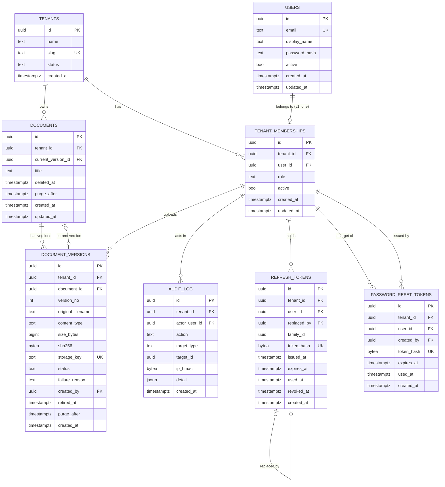
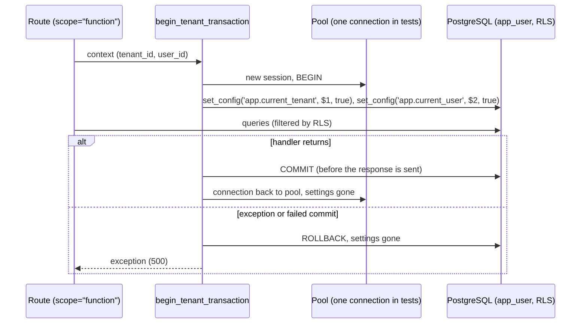

# Architecture — Grounded Answers

**Status:** Draft for review (Session 2, Step 3). Decisions are in `docs/adr/`. This file describes the resulting design.

**Last updated:** 2026-10-22

## 1. Tenancy model

- Every tenant owns its data. Tenant isolation is **enforced in PostgreSQL** with Row-Level Security (RLS). The application can't bypass it by accident.
- A **tenant** is a company (`tenants`). A **user** is a person (`users`), global across tenants. A **membership** links a user to a tenant with a role (`tenant_memberships`). v1 allows one membership per user (ADR 0004).
- Every tenant-owned table has `tenant_id NOT NULL` and an index. Each request sets the tenant context in the database for its transaction (ADR 0005).
- Decisions: [ADR 0004](adr/0004-authentication-self-built-jwt.md) (auth, roles, RLS exceptions), [ADR 0005](adr/0005-database-access-async-sqlalchemy.md) (database access), [ADR 0006](adr/0006-db-test-strategy.md) (tests).

## 2. Data model



The diagram shows key columns only. Section 3 has the full definitions.

## 3. Tables

### Keys used on tenant-owned tables

Every tenant-owned table has:
- `PRIMARY KEY (id)`. Surrogate UUID, generated in the app (ADR 0005).
- `UNIQUE (tenant_id, id)`. Composite foreign keys reference this constraint, so a row can only point at rows in its own tenant.
- `tenant_id uuid NOT NULL`, indexed.
- `created_at timestamptz NOT NULL DEFAULT now()`.

`tenants` and `users` are not tenant-owned. `tenants` *is* the tenant, and `users` is global identity (ADR 0004).

### `updated_at` trigger

`updated_at` on `users`, `tenant_memberships` and `documents` is maintained by one shared trigger function, `grounded.set_updated_at()`:

```sql
CREATE FUNCTION grounded.set_updated_at() RETURNS trigger
LANGUAGE plpgsql
SET search_path = pg_catalog, grounded
AS $$
BEGIN
  NEW.updated_at := now();
  RETURN NEW;
END;
$$;
-- one BEFORE UPDATE trigger per table, e.g.:
-- CREATE TRIGGER documents_set_updated_at BEFORE UPDATE ON grounded.documents
--   FOR EACH ROW EXECUTE FUNCTION grounded.set_updated_at();
```

- Not `SECURITY DEFINER`: it runs with the caller's privileges and writes only the row being updated, so it needs no elevation.
- `search_path` is pinned so an object in another schema can't shadow `now()`.
- The app never sets `updated_at` itself. The trigger is the single source of truth.

### `tenants`

| Column | Type | Constraints |
|---|---|---|
| id | uuid | PRIMARY KEY |
| name | text | NOT NULL, CHECK length 1–200 |
| slug | text | NOT NULL, UNIQUE, CHECK `slug ~ '^[a-z0-9-]{3,40}$'` |
| status | text | NOT NULL, CHECK in (`active`, `suspended`), DEFAULT `active` |
| created_at | timestamptz | NOT NULL DEFAULT now() |

Suspension blocks access without deleting data (ADR 0004, "Suspended tenants").

### `users` (global)

| Column | Type | Constraints |
|---|---|---|
| id | uuid | PRIMARY KEY |
| email | text | NOT NULL, UNIQUE, CHECK `email = lower(email)` |
| display_name | text | NOT NULL, CHECK length 1–120 |
| password_hash | text | NULL until setup. NULL means "reset not completed". Read only through the login function. |
| active | bool | NOT NULL DEFAULT true |
| created_at | timestamptz | NOT NULL DEFAULT now() |
| updated_at | timestamptz | NOT NULL DEFAULT now() |

### `tenant_memberships`

| Column | Type | Constraints |
|---|---|---|
| id | uuid | PRIMARY KEY |
| tenant_id | uuid | NOT NULL, FK → `tenants(id)`, indexed |
| user_id | uuid | NOT NULL, FK → `users(id)` |
| role | text | NOT NULL, CHECK in (`tenant_admin`, `employee`) |
| active | bool | NOT NULL DEFAULT true |
| created_at | timestamptz | NOT NULL DEFAULT now() |
| updated_at | timestamptz | NOT NULL DEFAULT now() |

Constraints: `UNIQUE (tenant_id, id)`, `UNIQUE (user_id)` (one membership per user in v1), `UNIQUE (tenant_id, user_id)` (target of composite foreign keys).

`platform_owner` is not a role here. Platform work runs through the admin CLI with the migration role (ADR 0004).

### `documents`

| Column | Type | Constraints |
|---|---|---|
| id | uuid | PRIMARY KEY |
| tenant_id | uuid | NOT NULL, indexed |
| title | text | NOT NULL, CHECK length 1–200 |
| current_version_id | uuid | NULL. Composite FK `(tenant_id, current_version_id)` → `document_versions(tenant_id, id)`, `DEFERRABLE INITIALLY DEFERRED`. NULL skips the check. |
| deleted_at | timestamptz | NULL. Set when an admin deletes the document. |
| purge_after | timestamptz | NULL. Set together with `deleted_at` (`deleted_at + DOCUMENT_RETENTION_DAYS`). |
| created_at | timestamptz | NOT NULL DEFAULT now() |
| updated_at | timestamptz | NOT NULL DEFAULT now() |

Constraints: `UNIQUE (tenant_id, id)`. Metadata only; file bytes are in storage.

- `CHECK ((deleted_at IS NULL) = (purge_after IS NULL))`. Both are set together or neither is set.

### `document_versions`

| Column | Type | Constraints |
|---|---|---|
| id | uuid | PRIMARY KEY |
| tenant_id | uuid | NOT NULL, indexed |
| document_id | uuid | NOT NULL. Composite FK `(tenant_id, document_id)` → `documents(tenant_id, id)`. |
| version_no | int | NOT NULL, CHECK ≥ 1, UNIQUE `(document_id, version_no)` |
| original_filename | text | NOT NULL, CHECK length 1–255. Sanitized on input (path separators, control characters and NUL removed). Display only; never used for paths or type decisions. |
| content_type | text | NOT NULL, CHECK in (`application/pdf`, `application/vnd.openxmlformats-officedocument.wordprocessingml.document`, `text/plain`, `text/markdown`). Set by the server's signature detector, not the client's header. |
| size_bytes | bigint | NOT NULL, CHECK `size_bytes BETWEEN 1 AND 10485760` (10 MiB) |
| sha256 | bytea | NOT NULL, CHECK `octet_length(sha256) = 32`. Dedupe is per tenant only (see 5.4). |
| storage_key | text | NOT NULL, UNIQUE, CHECK `storage_key LIKE 'tenant/' \|\| tenant_id::text \|\| '/%'`. Server-generated (`tenant/<tenant_id>/<uuid4>`), never derived from the filename. |
| status | text | NOT NULL, CHECK in (`queued`, `processing`, `ready`, `failed`, `retired`, `purging`) |
| failure_reason | text | NULL, CHECK length ≤ 500. Shown to admins. Never contains file content. |
| created_by | uuid | NOT NULL. Composite FK `(tenant_id, created_by)` → `tenant_memberships(tenant_id, user_id)`. |
| retired_at | timestamptz | NULL. Set when replaced or deleted. |
| purge_after | timestamptz | NULL. Set together with `retired_at`. |
| created_at | timestamptz | NOT NULL DEFAULT now() |

Constraints: `UNIQUE (tenant_id, id)`.

- `CHECK ((retired_at IS NULL) = (purge_after IS NULL))`. Both are set together or neither is set.
- `CHECK ((status IN ('retired', 'purging')) = (retired_at IS NOT NULL))`. A version is retired exactly when it's `retired` or `purging`.

**Status meanings:** `queued` and `processing` are ingestion. `ready` can be cited. `failed` is an ingestion failure with a reason. `retired` is replaced or deleted and waiting for purge. `purging` means the purge job has started and the row will be removed.

**Content detection** (server-side, the client header is ignored):
- **PDF:** starts with `%PDF-`.
- **DOCX:** a ZIP archive (`PK\x03\x04`) that contains `[Content_Types].xml` and `word/document.xml`. The ZIP check alone would accept any ZIP.
- **TXT and Markdown:** no magic bytes. The detector checks for valid UTF-8 with no NUL bytes. The `text/plain` vs `text/markdown` label comes from the extension allow-list, so it's a label, not a verified fact.

### `audit_log` (append-only)

| Column | Type | Constraints |
|---|---|---|
| id | uuid | PRIMARY KEY |
| tenant_id | uuid | NOT NULL, indexed with `created_at` |
| actor_user_id | uuid | NULL (NULL for system actions such as purge). Composite FK `(tenant_id, actor_user_id)` → `tenant_memberships(tenant_id, user_id)`. |
| action | text | NOT NULL, CHECK length 1–64. Examples: `login.success`, `login.failure`, `user.create`, `document.delete`, `document.purged`. |
| target_type | text | NULL |
| target_id | uuid | NULL |
| ip_hmac | bytea | NULL. HMAC-keyed IP (ADR 0004). Never a raw IP. |
| detail | jsonb | NULL. Small structured context. No secrets, no personal data, no file content, filenames or titles. |
| created_at | timestamptz | NOT NULL DEFAULT now() |

Append-only by grants: `app_user` has `INSERT` and `SELECT` only.

### `refresh_tokens`

| Column | Type | Constraints |
|---|---|---|
| id | uuid | PRIMARY KEY |
| tenant_id | uuid | NOT NULL, indexed |
| user_id | uuid | NOT NULL. Composite FK `(tenant_id, user_id)` → `tenant_memberships(tenant_id, user_id)`. Indexed. |
| family_id | uuid | NOT NULL, indexed. Revoking a family revokes every rotation in it. |
| replaced_by | uuid | NULL. Composite FK `(tenant_id, replaced_by)` → `refresh_tokens(tenant_id, id)`. |
| token_hash | bytea | NOT NULL, UNIQUE, CHECK `octet_length(token_hash) = 32`. SHA-256 of the token. Never the token. |
| issued_at | timestamptz | NOT NULL |
| expires_at | timestamptz | NOT NULL (14 days after `issued_at`) |
| used_at | timestamptz | NULL. Set on rotation. Reuse detection depends on it. |
| revoked_at | timestamptz | NULL |
| created_at | timestamptz | NOT NULL DEFAULT now() |

Constraints: `UNIQUE (tenant_id, id)`.

### `password_reset_tokens`

| Column | Type | Constraints |
|---|---|---|
| id | uuid | PRIMARY KEY |
| tenant_id | uuid | NOT NULL, indexed |
| user_id | uuid | NOT NULL. Composite FK `(tenant_id, user_id)` → `tenant_memberships(tenant_id, user_id)`. Indexed. |
| created_by | uuid | NOT NULL. Composite FK `(tenant_id, created_by)` → `tenant_memberships(tenant_id, user_id)`. |
| token_hash | bytea | NOT NULL, UNIQUE, CHECK `octet_length(token_hash) = 32` |
| expires_at | timestamptz | NOT NULL, CHECK `expires_at > created_at` (24 hours) |
| used_at | timestamptz | NULL. One use only. |
| created_at | timestamptz | NOT NULL DEFAULT now() |

Constraints: `UNIQUE (tenant_id, id)`.

## 4. Foreign keys and `ON DELETE` rules

**Every foreign key is `ON DELETE RESTRICT` and `ON UPDATE RESTRICT`.** Nothing cascades. Ids never change, so `ON UPDATE` is restricted too.

- A parent row with children can't be deleted. The app must delete children first, in the order in section 5.
- A composite foreign key includes `tenant_id`, so a child can only reference a parent in the same tenant. The database rejects a cross-tenant reference even if the app has a bug.
- A tenant is **suspended, not deleted**, in v1. There is no tenant-delete path. If one is added later, it gets its own ADR and purge job.

| Child → Parent | Columns | Notes |
|---|---|---|
| tenant_memberships → tenants | `tenant_id` | |
| tenant_memberships → users | `user_id` | Global identity. |
| documents → document_versions | `(tenant_id, current_version_id)` | Deferred. NULL skips the check. |
| document_versions → documents | `(tenant_id, document_id)` | |
| document_versions → tenant_memberships | `(tenant_id, created_by)` | |
| audit_log → tenant_memberships | `(tenant_id, actor_user_id)` | NULL skips the check (system actions). |
| refresh_tokens → tenant_memberships | `(tenant_id, user_id)` | |
| refresh_tokens → refresh_tokens | `(tenant_id, replaced_by)` | Rotation chain. |
| password_reset_tokens → tenant_memberships | `(tenant_id, user_id)` | |
| password_reset_tokens → tenant_memberships | `(tenant_id, created_by)` | |

## 5. Document lifecycle

### 5.1 States

- **Document:** `active` (`deleted_at IS NULL`) → `deleted` (`deleted_at` set, `purge_after` set) → purged (row removed).
- **Version:** `queued` → `processing` → `ready` → `retired` → `purging` → removed. `failed` can be retired too.

### 5.2 Upload and replace

1. Upload creates a `document_versions` row with `status = queued`. The bytes are stored under the server-generated `storage_key`.
2. Ingestion moves the version through `processing` to `ready` (or `failed` with a reason).
3. **Swap, in one transaction:** the new version becomes `ready` and `documents.current_version_id` points at it. The old current version becomes `retired`, with `retired_at = now()` and `purge_after = now() + DOCUMENT_RETENTION_DAYS`.

Answers cite only the current `ready` version. A `queued` or `processing` version is never cited.

### 5.3 Delete

One transaction: set `documents.deleted_at = now()` and `purge_after = now() + DOCUMENT_RETENTION_DAYS`. Set every version to `retired` with `retired_at` and `purge_after`. Write audit entry `document.delete` (no title, no filename). After commit, retrieval excludes the document (section 5.6).

**Restore is not supported in v1.**

### 5.4 Deduplication

`sha256` dedupe is **per tenant only**. Cross-tenant dedupe would reveal that another tenant holds the same file. Duplicate detection queries `(tenant_id, sha256)`, which is indexed but not unique.

### 5.5 Purge (retention job, runs in the Session 3 worker)

The purge job runs as **`worker_user`**, a dedicated LOGIN role with `NOBYPASSRLS` that is not a table owner (ADR 0007).

**Step 0: find due tenants.** The worker calls `grounded.retention_due_tenant_ids()`, a narrow `SECURITY DEFINER` function (owner `retention_definer`, hardened like the auth functions). It returns **only tenant ids** that have a due purge (`purge_after <= now()`), with no document data. The worker then processes each tenant separately:

```text
for tid in retention_due_tenant_ids():
    with tenant transaction(tid):          # set_config('app.current_tenant', tid, true)
        for each due version and deleted document in this tenant:
            run steps 1-6 below
```

Each tenant is processed under normal RLS, so the worker can't read or change another tenant's rows, even if the code has a bug.

For each due item, in this order (children first, because of RESTRICT):

1. **Mark** versions `purging` in a transaction. Retrieval already excludes them.
2. **Delete dependent data** (chunks and embeddings, from Session 3/4; see section 6).
3. **Delete stored bytes** at `storage_key`. Idempotent: a missing object counts as deleted.
4. **Delete the version row.** For a deleted document, first set `documents.current_version_id = NULL`.
5. **Delete the document row** once it has no versions left.
6. **Write audit entry** `document.purged` or `document_version.purged`, with `actor_user_id = NULL`, `tenant_id` set, and only counts in `detail`, for example `{"versions": 2, "chunks": 147, "bytes_deleted": true}`. No title, filename, hash or content.

**Crash safety:** a crash can leave versions in `purging`. The job is idempotent and resumes them. Retrieval excludes `purging` rows, so a half-purged document is never cited.

**Retention is recorded per row.** `purge_after` is written when the row is retired or deleted. Changing `DOCUMENT_RETENTION_DAYS` affects only rows retired after the change.

### 5.6 Retrieval rule (required)

An answer may cite only rows where **all** of these hold:
- `documents.deleted_at IS NULL`,
- the document's `current_version_id` points at this version,
- `document_versions.status = 'ready'`.

Chunks inherit this rule once they exist (section 6).

### 5.7 Required tests

1. **Immediate exclusion:** after a delete commits, the retrieval query returns no rows for that document. Same for a replaced version after the swap commits. Extended to chunks in Session 3/4.
2. **Purge completeness:** after purge, no `document_versions`, `documents`, stored bytes or dependent rows remain for that document. Session 3/4 adds dependent rows.
3. **Purge is idempotent:** a purge interrupted after the byte deletion but before the row deletion completes correctly when re-run.
4. **Content-free audit:** the `document.purged` entry's `detail` contains only allowed count keys. The test fails if it contains a title, filename, hash or any string from the document.
5. **Queued versions are not cited:** a `queued` or `processing` version never appears in retrieval.
6. **Tenant scoping:** tenant A's purge never touches tenant B's rows or bytes (proven through the composite keys and RLS).

### 5.8 Settings

- `DOCUMENT_RETENTION_DAYS`: integer, default `30`, range `1–365`. Validated in `Settings` at startup. Added to `.env.example` in Session 2, Step 4.

## 6. Chunks and embeddings (deferred)

**Not created in Session 2.** The embedding vector dimension depends on the embedding model decision, which is made in Session 3 or 4 (SPEC open decision #4). Creating the table earlier would hard-code a dimension we may change.

When it's created, the table will follow the same rules:
- `tenant_id NOT NULL`, indexed, `UNIQUE (tenant_id, id)`.
- `document_version_id`, with composite FK `(tenant_id, document_version_id)` → `document_versions(tenant_id, id)`, `ON DELETE RESTRICT`. Chunks are purged before their version (section 5.5, step 2).
- The `embedding` column type fixed by the chosen model. Keyword search uses a `tsvector` column.
- Retrieval uses the rule in section 5.6, plus the chunk's own status.

## 7. Row-Level Security summary

| Table | RLS | Policies |
|---|---|---|
| `tenants` | ENABLE + FORCE | `app_user`: SELECT own row. `auth_definer`: SELECT (login). Migration role: all (operator). |
| `users` | ENABLE + FORCE | `app_user`: SELECT and UPDATE through a membership in the current tenant. **No INSERT**: employees are created by `create_tenant_user` (ADR 0004 amendment). `provisioning_definer`: INSERT, `WITH CHECK (true)` (users is global; the membership insert in the same function is the gate). `auth_definer`: SELECT (login). |
| `tenant_memberships` | ENABLE + FORCE | `app_user`: tenant-scoped SELECT and UPDATE. **No INSERT** (only `create_tenant_user`). `provisioning_definer`: SELECT and INSERT, scoped to the session tenant. `auth_definer`: SELECT (login). |
| `documents` | ENABLE + FORCE | `app_user`: scoped to current tenant. `worker_user`: scoped to current tenant, SELECT and DELETE (DELETE only when deleted and with no versions left). |
| `document_versions` | ENABLE + FORCE | `app_user`: scoped to current tenant. `worker_user`: scoped to current tenant. UPDATE only `retired` to `purging`. DELETE only when `purging`. |
| `audit_log` | ENABLE + FORCE | `app_user`: scoped to current tenant, `INSERT` and `SELECT` only. `worker_user`: `INSERT` only. |
| `refresh_tokens` | ENABLE + FORCE | `app_user`: scoped to current tenant. `auth_definer`: SELECT (refresh). |
| `password_reset_tokens` | ENABLE + FORCE | `app_user`: scoped to current tenant (SELECT, INSERT, UPDATE). |
| `tenants` | ENABLE + FORCE | `app_user`: SELECT own row only. `auth_definer`: SELECT (login, `status` only). `migration_role`: all (operator). |
| `tenant_email_domains` | ENABLE + FORCE | `app_user`: SELECT, own tenant. `provisioning_definer`: SELECT, own tenant. `migration_role`: all (operator, the only writer). |
| `grounded.retention_due_tenant_ids()` | n/a (function) | Returns tenant ids only. Owner `retention_definer`, which has SELECT on `documents` and `document_versions` through `USING (true)` policies limited to that role. |
| `queue.*` (Procrastinate job queue, ADR 0015, 0016) | **none, by design** | No tenant column, so no RLS. Carries ids and job state only. Grants are the reviewed list in `tests/db/expected_queue_grants.json`; PUBLIC has none. Residual risk R17. |

- "Scoped to current tenant" means `tenant_id = NULLIF(current_setting('app.current_tenant', true), '')::uuid`. With no tenant set, every policy returns zero rows (fail closed).
- **Tenant-owned tables are never written without a tenant.** `app_user`'s INSERT on `users` is the only INSERT that isn't tenant-scoped at the policy level. It's safe because a user row has no tenant access until a membership row exists, and the membership insert is tenant-scoped.

### 7.1 Database roles

| Role | Login | Attributes | Purpose |
|---|---|---|---|
| `migration_role` | yes (`MIGRATION_DATABASE_URL`) | NOSUPERUSER, NOBYPASSRLS | Owns the schema, tables, functions and triggers. Runs Alembic and the admin CLI. Never used by the web app or the worker. |
| `app_user` | yes (`DATABASE_URL`) | NOSUPERUSER, NOBYPASSRLS, NOCREATEDB, NOCREATEROLE, NOINHERIT | Web app. Tenant-scoped by RLS. |
| `worker_user` | yes (worker only) | NOSUPERUSER, NOBYPASSRLS, NOCREATEDB, NOCREATEROLE, NOINHERIT | Retention purge job. Tenant-scoped by RLS, plus one tenant-id function. |
| `auth_definer` | **no** (NOLOGIN) | NOBYPASSRLS | Owns the login and refresh functions (ADR 0004). |
| `retention_definer` | **no** (NOLOGIN) | NOBYPASSRLS | Owns `retention_due_tenant_ids()` (ADR 0007). |
| `provisioning_definer` | **no** (NOLOGIN) | NOBYPASSRLS | Owns `create_tenant_user()` (ADR 0004 amendment). |

- No role has `BYPASSRLS` or `SUPERUSER`, except the cluster admin used only for bootstrap (locally the Docker `postgres` user; on a managed host, the provider's owner role). The app and the worker never connect as that role.
- `NOINHERIT` on login roles prevents them from picking up privileges through membership in the definer roles.
- The bootstrap plan (roles and grants) is in ADR 0006 and the Step 4 SQL. Grants are versioned Alembic migrations, not one-off commands.

## 8. Open items

- **Chunks table:** deferred to Session 3/4, pending the embedding model decision.
- **Document storage backend:** `storage_key` is a logical key. The backend (local disk or object storage) is decided later.
- **Retention decision:** recorded in ADR 0007 (Proposed). Includes the purge worker design, the backup limitation and the open question on the 30-day default.
- **Backups:** purge removes live data, not backup copies. The backup retention window depends on the hosting provider and must be recorded in SECURITY.md and RUNBOOK when the host is chosen.
- **SPEC §6.1:** proposed update for retention and deletion is in the ADR 0007 review. It needs approval before it's applied.

## 9. Data access layer (Session 3, Step 2)

ADR 0005 and ADR 0011 are the sources. The code is in `backend/src/grounded_answers/`:
`models.py` (ORM mirror of the tables), `tenant_db.py` (the only way to start a tenant
transaction), `rowcount.py` (write checks, SECURITY R9), `database.py` (engine and session factory).

### 9.1 One tenant transaction



### 9.2 Authentication (Session 3, Step 3a; ADR 0012)

- Access tokens: EdDSA JWT, 15 minutes, `iss` `grounded-answers-api`, `aud` `grounded-answers-web`, `kid` header
  from the key file (`auth_keys.py`, `auth_tokens.py`).
- Login: `auth_service.login`. Anonymous lookup, Argon2 verify in a worker thread on every path, checks, then
  one tenant transaction for the refresh token and the audit row (`auth_api.py` for the routes).
- Protected routes: `authenticated_context` verifies the token, opens the tenant transaction, and re-reads
  membership, user and tenant status from the database. Role comes from the row.

### 9.2b Refresh and logout (Session 3, Step 3b; ADR 0013)

- `auth_refresh.py`: the cookie is hashed and looked up, then the tenant transaction locks the token row with
  `SELECT ... FOR UPDATE`. Decisions are made on the locked row. Writes are committed before any error reaches
  the client.
- Routes (`auth_api.py`): `POST /auth/refresh`, `POST /auth/logout` (both need an allowed Origin),
  `POST /auth/logout-all` (bearer token).

### 9.2c Login protection (Session 3, Step 3c; ADR 0014)

- `rate_limit.py`: `LoginLimiter` keeps the limits in Valkey. `RECORD_FAILURE_LUA` counts and locks in one
  script. Keys are HMAC'd and expire.
- `timing.py`: `TimingFloor`. Every login response waits until 500 ms have passed (R11).
- Order on login: limit check (before the lookup), lookup, Argon2 verify, checks, then on failure record it.

### 9.3 Rules

| Rule | Enforced by |
|---|---|
| Only `begin_tenant_transaction` sets the tenant or user context | `tests/test_tenant_context_source.py` |
| Context values are transaction-local and bound | `tests/db/test_tenant_transaction.py` (statement order and parameters) |
| No tenant context survives a pooled connection's next transaction | `tests/db/test_tenant_transaction.py` (commit, rollback, error; same backend pid) |
| Every relationship is `lazy="raise"` | `tests/test_models.py` |
| `password_hash` and `updated_at` on users are deferred | `tests/test_models.py`, `tests/db/test_orm_models.py` |
| Models and migrations agree on tables, columns, keys and indexes | `tests/db/test_orm_metadata.py` (Alembic comparison) |
| Models and migrations agree on CHECK names and definitions | `tests/db/test_orm_metadata.py` (`expected_checks.json`) |
| A failed commit is a server error, not a success | `tests/db/test_tenant_dependency.py` |
| A write that affects an unexpected number of rows is refused | `tests/db/test_rowcount.py` |
